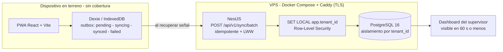

# Capstone — Terreno Conectado, Decisiones en Tiempo Real

**Asignatura:** Capstone (PTY4614) · **Escuela:** Informática y Telecomunicaciones · **Carrera:** Ingeniería en Informática · **Sede:** Alameda

Este repositorio contiene **todas las evidencias documentales** del proceso de Portafolio de Título, organizadas por fase según la estructura entregada por la asignatura. El proyecto en sí (código, especificaciones y documentación técnica) vive en el repositorio [terreno-conectado](https://github.com/danielandresavilaj-cell/terreno-conectado).

---

## 1. Nombre del proyecto

**Terreno Conectado, Decisiones en Tiempo Real** — *Datos al día, donde no hay señal.*

## 2. Descripción

Plataforma **SaaS offline-first** de captura de datos operacionales para la industria minera y de construcción en Chile.

| | |
| :--- | :--- |
| **Qué hace** | Permite registrar inspecciones, bitácoras y datos operacionales **directamente en el dispositivo del terreno, incluso sin conexión a internet**, y sincroniza esa información automáticamente con la nube en cuanto se recupera la señal. |
| **A quién va dirigido** | Equipos de terreno, supervisores, jefes de faena/obra y gerencias de empresas mineras y de construcción, que hoy capturan información en papel o planillas. |
| **Qué problema resuelve** | La conectividad intermitente en faenas remotas hace que la información llegue tarde, con errores y duplicada, y que los riesgos de seguridad se detecten demasiado tarde. La plataforma reduce la brecha entre el dato capturado en terreno y la decisión gerencial. |
| **Modelo de negocio** | Multi-tenant: una misma plataforma sirve a varias empresas cliente manteniendo sus datos aislados y seguros (Row-Level Security en PostgreSQL). |

## 3. Tecnologías utilizadas

| Capa | Tecnología |
| :--- | :--- |
| Lenguaje | **TypeScript** full-stack |
| Frontend | PWA **React 18 + Vite**, service worker (Workbox) |
| Almacenamiento local | **Dexie** (IndexedDB) con cola offline transaccional |
| Backend | **NestJS** (monolito modular) sobre Node.js |
| Base de datos | **PostgreSQL 16** con Row-Level Security |
| Identidad | JWT propio (access + refresh), UUIDv7 generado en cliente |
| Infraestructura | **Docker Compose + Caddy** (TLS automático) en un VPS |
| CI/CD | GitHub Actions |
| Pruebas | Vitest, Playwright, Testcontainers |

## 4. Instrucciones para ejecutar el proyecto localmente

El código del proyecto **no se encuentra en este repositorio** (aquí solo hay documentos). Para ejecutarlo:

```bash
git clone https://github.com/danielandresavilaj-cell/terreno-conectado.git
cd terreno-conectado

pnpm install                                          # instala los workspaces
docker compose -f infra/docker-compose.yml up -d      # PostgreSQL 16

pnpm --filter backend start:dev                       # NestJS  -> :3000
pnpm --filter frontend dev                            # Vite    -> :5173

pnpm seed:demo                                        # tenants de prueba (FR-006)
pnpm test                                             # unit + integración
```

| Servicio | URL |
| :--- | :--- |
| Frontend (Vite) | http://localhost:5173 |
| Backend (NestJS) | http://localhost:3000 |
| Health check | http://localhost:3000/health |

Detalle completo de la ejecución en el [README de terreno-conectado](https://github.com/danielandresavilaj-cell/terreno-conectado#cómo-ejecutar-localmente).

## 5. Integrantes del equipo y sus roles

| Integrante | Rol | GitHub |
| :--- | :--- | :--- |
| Daniel Ávila | **Datos y lógica de negocio** — modelamiento de datos, reglas de sincronización, specs | [@danielandresavilaj-cell](https://github.com/danielandresavilaj-cell) |
| Raúl González | **Infraestructura, plataforma y validación** — contenedores, despliegue, pruebas automatizadas | [@ev6rlasting](https://github.com/ev6rlasting) |

## 6. Metodología de trabajo del equipo

**Spec Driven Development (SDD)** sobre ciclos ágiles de aproximadamente dos semanas.

```
spec → plan → tasks → código → tests → evidencia
```

- Todo artefacto de código nace de un spec; ninguna tarea se ejecuta sin requisito trazable (FR/NFR).
- Cada ciclo cierra con revisión conjunta del avance y ajuste de las tareas siguientes.
- Specs en **español**; código, tests, commits y CI en **inglés**.
- Tablero compartido con Definition of Ready / Definition of Done, límite de WIP y trazabilidad commit → issue.
- Multi-tenant con aislamiento a nivel de motor y presupuesto objetivo de ~US$5/mes.

## 7. Arquitectura de la solución

El terreno nunca depende de la red: **la captura es siempre local y la sincronización ocurre después**.



**Decisiones estructurales que sostienen la promesa**

- **Offline-first real.** Todo el flujo de captura funciona sin red; la nube es complemento, nunca requisito.
- **Idempotencia.** Reenviar un lote nunca duplica: *upsert* por UUIDv7 de cliente. Los conflictos se resuelven con LWW determinista y ambas versiones quedan auditadas en `CONFLICT_RECORD`.
- **Aislamiento por motor.** Cada tabla de dominio lleva `tenant_id` y una política RLS.

Diagrama y detalle completo en el [README de terreno-conectado](https://github.com/danielandresavilaj-cell/terreno-conectado#arquitectura).

---

## Estructura de este repositorio

```
Capstone/
├── Fase 1/  ← COMPLETADA
│   ├── Evidencias Grupales/
│   │   ├── 1.4_APT122_FormativaFase1.docx
│   │   ├── 1.5_GuiaEstudiante_Fase 1_Definicion Proyecto APT.docx
│   │   ├── Informe_Definicion_Proyecto_APT_Fase1.docx
│   │   ├── Presentacion_Fase1_Terreno_Conectado.pdf
│   │   ├── Carta_GANTT.jpeg
│   │   └── PLANILLA DE EVALUACIÓN FASE 1.xlsx
│   └── Evidencias Individuales/
│       ├── Daniel_Avila/    → 1.1, 1.2, 1.3
│       └── Raul_Gonzalez/  → 1.1, 1.2, 1.3
└── Fase 2/  ← PENDIENTE (plantillas oficiales en blanco)
    ├── Evidencias Grupales/            → 2.4, 2.6
    ├── Evidencias Individuales/        → 2.1 por integrante
    ├── Evidencias Proyecto (version Agil)/   → Product Vision, Backlog, DoD, Diseño
    └── Evidencias Proyecto (version Cascada)/ → Requerimientos, Diseño
```

### Qué contiene cada evidencia

| Documento | Qué es |
| :--- | :--- |
| `1.1 Autoevaluación Competencias` | Nivel de logro (ED/AD/DA/DP/DNL) por competencia del perfil de egreso, con comentarios. |
| `1.2 Diario Reflexión` | Reflexión individual: fortalezas, oportunidades de mejora, intereses profesionales y relación con el Proyecto APT. |
| `1.3 Autoevaluación Fase 1` | Rúbrica de autoevaluación de la definición del proyecto. |
| `1.4 Formativa Fase 1` | Pauta de evaluación formativa (semana 2). |
| `1.5 Guía Estudiante` | Formulario oficial de definición del Proyecto APT, completo por el equipo. |
| `Informe_Definicion_Proyecto_APT_Fase1` | Informe de fase 1 con abstract, resumen, fundamentación, objetivos, metodología, evidencias, plan de trabajo y Carta Gantt. |
| `PLANILLA DE EVALUACIÓN FASE 1` | Planilla de evaluación grupal e individual. |

Los documentos de Fase 2 son las **plantillas oficiales de la asignatura**, aún sin completar: se llenarán a medida que avance el desarrollo del proyecto.

## Enlaces

| Qué | Enlace |
| :--- | :--- |
| Repositorio del proyecto (código y specs) | https://github.com/danielandresavilaj-cell/terreno-conectado |
| Este repositorio (evidencias) | https://github.com/danielandresavilaj-cell/Capstone |
| Tablero del equipo | https://github.com/users/danielandresavilaj-cell/projects/1 |
