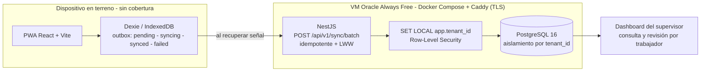

# Capstone — Terreno Conectado, Decisiones en Tiempo Real

**Asignatura:** Capstone (PTY4614) · **Escuela:** Informática y Telecomunicaciones · **Carrera:** Ingeniería en Informática · **Sede:** Alameda

Este repositorio contiene **todas las evidencias documentales** del proceso de Portafolio de Título, organizadas por fase según la estructura entregada por la asignatura. El proyecto en sí (código, especificaciones y documentación técnica) vive en el repositorio [terreno-conectado](https://github.com/danielandresavilaj-cell/terreno-conectado).

---

## 1. Nombre del proyecto

**Terreno Conectado, Decisiones en Tiempo Real** — *Datos al día, donde no hay señal.*

## 2. Descripción

Plataforma **SaaS offline-first** de captura de datos operacionales para la industria minera y de construcción en Chile.

| | |
| :--- | :--- |
| **Qué hace** | Permite registrar inspecciones, bitácoras y datos operacionales **directamente en el dispositivo del terreno, incluso sin conexión a internet**, y sincroniza esa información automáticamente con la nube en cuanto se recupera la señal. |
| **A quién va dirigido** | Equipos de terreno, supervisores, jefes de faena/obra y gerencias de empresas mineras y de construcción, que hoy capturan información en papel o planillas. |
| **Qué problema resuelve** | La conectividad intermitente en faenas remotas hace que la información llegue tarde, con errores y duplicada, y que los riesgos de seguridad se detecten demasiado tarde. La plataforma reduce la brecha entre el dato capturado en terreno y la decisión gerencial. |
| **Modelo de negocio** | Multi-tenant: una misma plataforma sirve a varias empresas cliente manteniendo sus datos aislados y seguros (Row-Level Security en PostgreSQL). |

## 3. Tecnologías utilizadas

| Capa | Tecnología |
| :--- | :--- |
| Lenguaje | **TypeScript** full-stack |
| Frontend | PWA **React 18 + Vite**, service worker (Workbox) |
| Almacenamiento local | **Dexie** (IndexedDB) con cola offline transaccional |
| Backend | **NestJS** (monolito modular) sobre Node.js |
| Base de datos | **PostgreSQL 16** con Row-Level Security |
| Identidad | JWT propio (access + refresh), UUIDv7 generado en cliente |
| Infraestructura | **Docker Compose + Caddy** (TLS automático) en una VM **Oracle Always Free** (US$0/mes) |
| CI/CD | GitHub Actions |
| Pruebas | Vitest, Playwright, Testcontainers |

## 4. Instrucciones para ejecutar el proyecto localmente

El código del proyecto **no se encuentra en este repositorio** (aquí solo hay documentos). Para ejecutarlo:

```sh
git clone https://github.com/danielandresavilaj-cell/terreno-conectado.git
cd terreno-conectado
npm ci
```

Configurar `.env` local desde su plantilla, levantar PostgreSQL, migrar y sembrar según la [guía de aplicación de Fase 2](Fase%202/Evidencias%20Proyecto/Sistema/Aplicacion/README.md). El código usa npm workspaces. El producto está publicado en https://terrenoconectado.cl (la app en https://terrenoconectado.cl/app/).


| Servicio | URL |
| :--- | :--- |
| Frontend (Vite) | http://localhost:5173 |
| Backend (NestJS) | http://localhost:3000 |
| Health check | http://localhost:3000/health |

Detalle completo de la ejecución en el [README de terreno-conectado](https://github.com/danielandresavilaj-cell/terreno-conectado#cómo-ejecutar-localmente).

## 5. Integrantes del equipo y sus roles

| Integrante | Rol | GitHub |
| :--- | :--- | :--- |
| Daniel Ávila | **Datos y lógica de negocio** — modelamiento de datos, reglas de sincronización, specs | [@danielandresavilaj-cell](https://github.com/danielandresavilaj-cell) |
| Raúl González | **Infraestructura, plataforma y validación** — contenedores, despliegue, pruebas automatizadas | [@ev6rlasting](https://github.com/ev6rlasting) |

## 6. Metodología de trabajo del equipo

**Metodología ágil: Scrum adaptado a un equipo de dos personas**, con **Spec Driven Development (SDD)**: cada tarea nace de un requisito (FR/NFR) del spec maestro.

```
spec → plan → tasks → código → tests → evidencia
```

- **Sprints de dos semanas**, como se declaró en la Fase 1. Planificación los lunes (del Product Backlog al sprint, con Definition of Ready) y revisión y retrospectiva los viernes.
- **Tablero** de GitHub Projects ([Sprint Board](https://github.com/users/danielandresavilaj-cell/projects/1)), con un máximo de 2 tarjetas en curso por persona; una tarjeta = una rama = un PR; seguimiento diario y comentario de traspaso en cada tarjeta.
- **Definition of Done**: CI en verde (lint, tipos, build, pruebas y escaneo de secretos), spec actualizado en el mismo PR y revisión contra el criterio de aceptación.
- Specs, documentación y commits en **español**.

| Sprint | Fechas (2026) | Objetivo | Resultado |
| :--- | :--- | :--- | :--- |
| Sprint 0 | 14 sep – 27 sep | Definir y especificar el producto | Constitución, spec maestro, ADR firmados, plan del primer incremento |
| Sprint 1 | 28 sep – 11 oct | Recorrido mínimo: captura sin señal → sincronización → Gerencia; formularios desde Excel | 38 PR integrados |
| Sprint 2 | 12 oct – 18 oct | Exportación, pruebas E2E y de caos, demo publicada y entrega de Fase 2 (16 oct) | 50 PR integrados |
| Receso | 19 oct – 8 nov | Receso académico y proceso de prácticas | — |
| Sprint 3 | 9 nov – 19 nov | v1 en producción con cuentas reales, firma, QR y presentación final | 95 PR integrados |

**Artefactos ágiles** ([carpeta](Fase%202/Evidencias%20Proyecto%20%28version%20Agil%29/)):
[Product Vision](Fase%202/Evidencias%20Proyecto%20%28version%20Agil%29/Documento%2001-%20Product%20Vision.docx) ·
[Product Backlog](Fase%202/Evidencias%20Proyecto%20%28version%20Agil%29/Documento%2002-%20Product%20Backlog.docx) ·
[Sprint Backlog](Fase%202/Evidencias%20Proyecto%20%28version%20Agil%29/Documento%2003%20-%20Sprint%20Backlog.docx) ·
[Definition of Done](Fase%202/Evidencias%20Proyecto%20%28version%20Agil%29/Documento%2004-%20Definition%20of%20Done.docx) ·
[Documento de Diseño](Fase%202/Evidencias%20Proyecto%20%28version%20Agil%29/Documento%2005%20-%20Documento%20de%20Dise%C3%B1o.docx) ·
[Retrospectivas](Fase%202/Evidencias%20Proyecto%20%28version%20Agil%29/Documento%2006%20-%20Retrospectivas.docx)

## 7. Arquitectura de la solución

El terreno nunca depende de la red: **la captura es siempre local y la sincronización ocurre después**.



**Decisiones estructurales que sostienen la promesa**

- **Offline-first real.** Todo el flujo de captura funciona sin red; la nube es complemento, nunca requisito.
- **Idempotencia.** Reenviar un lote nunca duplica: *upsert* por UUIDv7 de cliente. Los conflictos se resuelven con LWW determinista y ambas versiones quedan auditadas en `CONFLICT_RECORD`.
- **Aislamiento por motor.** Cada tabla de dominio lleva `tenant_id` y una política RLS.

Diagrama y detalle completo en el [README de terreno-conectado](https://github.com/danielandresavilaj-cell/terreno-conectado#arquitectura).

---

## Estructura de este repositorio

```
Capstone/
├── Fase 1/  ← COMPLETADA
│   ├── Evidencias Grupales/
│   │   ├── 1.4_APT122_FormativaFase1.docx
│   │   ├── 1.5_GuiaEstudiante_Fase 1_Definicion Proyecto APT.docx
│   │   ├── Informe_Definicion_Proyecto_APT_Fase1.docx
│   │   ├── Presentacion_Fase1_Terreno_Conectado.pdf
│   │   ├── Carta_GANTT.jpeg
│   │   └── PLANILLA DE EVALUACIÓN FASE 1.xlsx
│   └── Evidencias Individuales/
│       ├── Daniel_Avila/    → 1.1, 1.2, 1.3
│       └── Raul_Gonzalez/  → 1.1, 1.2, 1.3
├── Fase 2/  ← EVIDENCIAS AL CORTE 16-10-2026 · DOCUMENTOS ÁGILES ACTUALIZADOS AL 18-11-2026
│   ├── Evidencias Grupales/            → 2.4, 2.6
│   ├── Evidencias Individuales/        → 2.1 por integrante
│   ├── Evidencias Proyecto (version Agil)/   → 01 Product Vision, 02 Product Backlog, 03 Sprint Backlog,
│   │                                          04 Definition of Done, 05 Diseño, 06 Retrospectivas
│   └── Evidencias Proyecto/ → Presentación, documentación y sistema
└── Fase 3/  ← CIERRE DEL PROYECTO APT · PRESENTACIÓN FINAL 19-11-2026
    ├── Evidencias Grupales/            → Presentación Proyecto.pdf
    ├── Evidencias Individuales/        → Diario de reflexión 3.1 por integrante
    └── Evidencias Proyecto/Documentacion/Diagramas/ → 5 diagramas SVG actualizados
```

### Qué contiene cada evidencia

| Documento | Qué es |
| :--- | :--- |
| `1.1 Autoevaluación Competencias` | Nivel de logro (ED/AD/DA/DP/DNL) por competencia del perfil de egreso, con comentarios. |
| `1.2 Diario Reflexión` | Reflexión individual: fortalezas, oportunidades de mejora, intereses profesionales y relación con el Proyecto APT. |
| `1.3 Autoevaluación Fase 1` | Rúbrica de autoevaluación de la definición del proyecto. |
| `1.4 Formativa Fase 1` | Pauta de evaluación formativa (semana 2). |
| `1.5 Guía Estudiante` | Formulario oficial de definición del Proyecto APT, completo por el equipo. |
| `Informe_Definicion_Proyecto_APT_Fase1` | Informe de fase 1 con abstract, resumen, fundamentación, objetivos, metodología, evidencias, plan de trabajo y Carta Gantt. |
| `PLANILLA DE EVALUACIÓN FASE 1` | Planilla de evaluación grupal e individual. |

La entrega de Fase 2 completa las guías oficiales y los documentos ágiles e incorpora evidencia de aplicación y base de datos. Consultar el [índice de Fase 2](Fase%202/README.md) para resultados, aportes y pendientes de aceptación. La entrega de Fase 3 cierra el proyecto con la presentación final, el diario de reflexión de cada integrante y los diagramas actualizados. Consultar el [índice de Fase 3](Fase%203/README.md).

## Enlaces

| Qué | Enlace |
| :--- | :--- |
| Repositorio del proyecto (código y specs) | https://github.com/danielandresavilaj-cell/terreno-conectado |
| Este repositorio (evidencias) | https://github.com/danielandresavilaj-cell/Capstone |
| Tablero del equipo | https://github.com/users/danielandresavilaj-cell/projects/1 |
